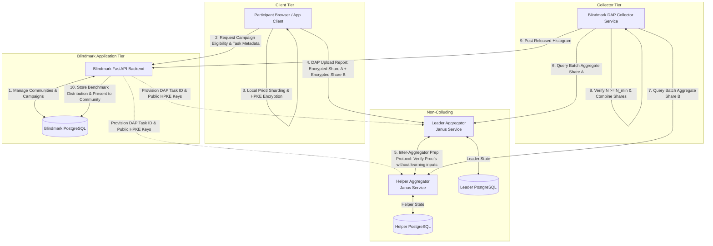

# Blindmark — Phase 6A: Cryptographic Architecture & System Design

**Document Status:** Architecture Design  
**Application Target:** Internship Stipend & Compensation Benchmarking

---

## 1. Initial Benchmark Measurement Model (Internship Stipends)

### 1.1 Fixed Histogram Bucket Configuration
For the initial benchmark, Blindmark establishes a 12-bucket monthly stipend histogram (USD equivalent):

| Bucket Index | Monthly Stipend Range | Hourly Equivalent (40h/wk) |
| :---: | :---: | :---: |
| **0** | $< \$2,000$ | $< \$12.50 / \text{hr}$ |
| **1** | $\$2,000 - \$3,499$ | $\$12.50 - \$21.87 / \text{hr}$ |
| **2** | $\$3,500 - \$4,999$ | $\$21.88 - \$31.24 / \text{hr}$ |
| **3** | $\$5,000 - \$6,499$ | $\$31.25 - \$40.62 / \text{hr}$ |
| **4** | $\$6,500 - \$7,999$ | $\$40.63 - \$49.99 / \text{hr}$ |
| **5** | $\$8,000 - \$9,499$ | $\$50.00 - \$59.37 / \text{hr}$ |
| **6** | $\$9,500 - \$10,999$ | $\$59.38 - \$68.74 / \text{hr}$ |
| **7** | $\$11,000 - \$12,499$ | $\$68.75 - \$78.12 / \text{hr}$ |
| **8** | $\$12,500 - \$13,999$ | $\$78.13 - \$87.49 / \text{hr}$ |
| **9** | $\$14,000 - \$15,999$ | $\$87.50 - \$99.99 / \text{hr}$ |
| **10** | $\$16,000 - \$19,999$ | $\$100.00 - \$124.99 / \text{hr}$ |
| **11** | $\ge \$20,000$ | $\ge \$125.00 / \text{hr}$ |

### 1.2 Mathematical & Cryptographic Parameters
- **VDAF Scheme:** `Prio3Histogram`
- **Finite Field:** Field size $p = 2^{31} - 1$ (Mersenne 31 prime field `prio::field::FieldElement<Field31>`).
- **Input Encoding:** One-hot vector of length $K = 12$.
- **Chunk Length:** Default parallel sum gadget chunk size $C = 4$.
- **Batch Window / Epoch:** Task collection window duration (e.g. 7 days or campaign duration).
- **Minimum Cohort Threshold ($N_{\min}$):** Minimum $20$ distinct participant reports before collector unsharing is authorized.

---

## 2. Target System Architecture

---

## 3. Tier Responsibilities & Separation of Concerns

### A. Client Tier (Browser / Desktop Application)
- **Local Secret Sharding:** Runs WebAssembly (Wasm) compiled from `libprio-rs` / `janus_client`.
- Maps user stipend input into single bucket $b \in [0, 11]$.
- Encodes vector $V \in \{0, 1\}^{12}$ where $V[b] = 1$.
- Generates FLP validity proof.
- Encrypts `input_share_1` using Leader's HPKE public key, and `input_share_2` using Helper's HPKE public key.
- Dispatches DAP `Report` payload to the Leader aggregator over HTTPS.
- **Privacy Invariant:** Raw dollar stipend and bucket selection never leave the client's local memory.

### B. Leader Aggregator Tier (Independent Organization 1)
- Receives DAP reports from clients.
- Enforces batch window and report deduplication.
- Drives the DAP verification protocol with the Helper.
- Accumulates verified `input_share_1` into its local running aggregate share.
- Maintains zero access to `input_share_2`.

### C. Helper Aggregator Tier (Independent Organization 2)
- Exposes authenticated HTTPS endpoints to the Leader.
- Receives verification requests containing client public shares and encrypted Helper input shares.
- Decrypts `input_share_2` using its private HPKE key.
- Computes FLP proof verification state.
- If verified, accumulates `input_share_2` into its local running aggregate share.
- Maintains zero access to `input_share_1`.

### D. Collector Tier (Blindmark Benchmark Collector)
- When campaign batch window closes, initiates collection job across both aggregators.
- Requests aggregate share $S_A$ from Leader and $S_B$ from Helper.
- Validates that total count $M \ge N_{\min} = 20$.
- Combines shares over finite field:
  $$H_{\text{released}} = S_A + S_B \pmod p$$
- Forwards final distribution to the Blindmark application backend.

### E. Blindmark Application Backend (Existing FastAPI & PostgreSQL)
- Retains existing responsibility: community creation, campaign lifecycle, metadata management, and authenticated administrative operations.
- Provisions task configurations in DAP aggregators via Janus Admin API.
- Stores and displays **only aggregate histogram results** ($H_{\text{released}}$).

---

## 4. Trust Model & Security Analysis

### 4.1 Non-Collusion Invariant
The fundamental privacy guarantee of DAP and Prio3 rests on the **two-aggregator non-collusion assumption**:
$$\text{Leader and Helper must be operated by legally, operationally, and infrastructure-independent entities.}$$

| Threat Scenario | System Outcome & Impact |
| :--- | :--- |
| **Malicious Leader** | **Privacy Preserved.** Leader only has Share 1. Without Share 2 (held encrypted or accumulated by Helper), Share 1 is uniformly random in the finite field. Leader cannot decrypt individual measurements. Leader can attempt denial of service or drop reports, but cannot forge valid client inputs without failing FLP verification. |
| **Malicious Helper** | **Privacy Preserved.** Helper only has Share 2. Cannot reconstruct measurements. Cannot forge aggregate shares without causing unsharing failure if verified. |
| **Colluding Aggregators** | **PRIVACY FAILS.** If Leader and Helper exchange their internal database shares or private HPKE keys, they can reconstruct every individual measurement in the batch. |
| **Malicious Client** | **Integrity Preserved.** If client attempts to submit negative numbers, multiple buckets, or large scalars, the zero-knowledge FLP proof verification fails. The report is rejected during preparation and never enters the aggregate. |
| **Replay & Sybil Attacks** | **DAP Deduplication + Eligibility:** DAP verifies report nonce uniqueness within the epoch. Client eligibility whitelisting ensures only authorized community members receive submission tokens. |
| **Small Cohort Leakage** | **Protected by Threshold Gate:** The Collector strictly refuses to unshard or release results unless total participant count $M \ge 20$. |
