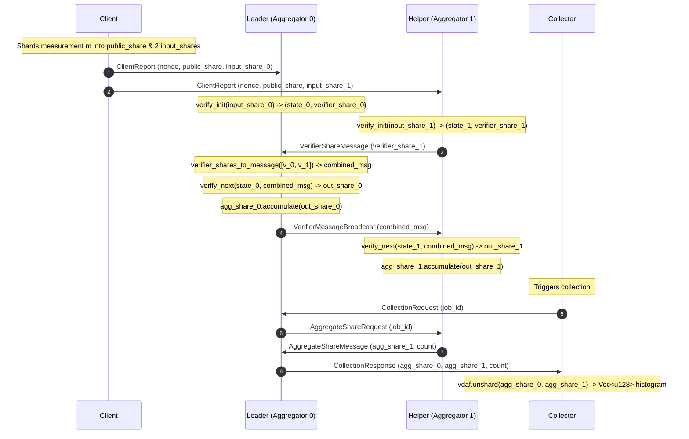

# Phase 6C Architecture: Modular Two-Aggregator Prio3 Protocol

## 1. Overview & Objectives

Phase 6C advances Blindmark from an isolated script simulation (`experiments/rust_prio3_demo`) into a structured, modular four-component architecture (`experiments/phase_6c`):
- **Client**: Input measurement sharding and unlinked report generation.
- **Leader Aggregator**: Round 1 verification, message aggregation, and collection orchestration.
- **Helper Aggregator**: Independent Round 1 verification, Round 2 verification, and isolated aggregate share maintenance.
- **Collector**: Triggering collection, collecting additive aggregate shares from both aggregators, and final unsharding.

This architecture establishes strict component boundaries and explicit serializable message types over an in-memory transport abstraction without premature network or production DAP overhead.

---

## 2. Component Boundaries & Responsibilities

```
                      +-------------------+
                      |      Client       |
                      +-------------------+
                        /               \
       Leader Report   /                 \  Helper Report
      (input_share_0) /                   \ (input_share_1)
                     v                     v
            +-----------------+    +-----------------+
            |     Leader      |<-->|     Helper      |
            |   Aggregator    |    |   Aggregator    |
            |     (agg 0)     |    |     (agg 1)     |
            +-----------------+    +-----------------+
                     \                     /
        Leader Share  \                   / Helper Share
        (agg_share_0)  \                 /  (agg_share_1)
                        v               v
                      +-------------------+
                      |     Collector     |
                      +-------------------+
```

### 2.1 Client (`client.rs`)
- **Input**: Integer bucket index in `[0, NUM_BUCKETS)` (0..11).
- **Cryptographic Action**: Invokes `prio::vdaf::Client::shard(&[], &measurement, &nonce)`.
- **Output**: Generates two distinct `ClientReport` messages:
  - Leader Report contains `public_share`, `nonce`, and `input_share_0`.
  - Helper Report contains `public_share`, `nonce`, and `input_share_1`.
- **Invariants**:
  - The raw measurement is discarded and never leaves client memory.
  - Input share 0 is never transmitted or accessible to the Helper.
  - Input share 1 is never transmitted or accessible to the Leader.

### 2.2 Leader Aggregator (`leader.rs`)
- **Role**: Coordinates verification exchange and maintains Aggregator 0 state.
- **State**:
  - `pending_verifications`: Map from `ReportId` to `(Prio3VerifyState, Prio3VerifierShare)`.
  - `aggregate_share`: Private `Option<AggregateShare<Field128>>` accumulated via `Aggregatable::accumulate`.
  - `accepted_count`: Tracks valid reports accumulated.
  - `processed_reports`: De-duplication set.
- **Verification Operations**:
  - Executes `vdaf.verify_init` on Leader input share.
  - Receives `VerifierShareMessage` from Helper.
  - Executes `vdaf.verifier_shares_to_message(&[], &(), vec![leader_share, helper_share])`.
  - Executes `vdaf.verify_next(&[], state, msg)` to produce Leader's `OutputShare`.
  - Accumulates `OutputShare` into its private `AggregateShare`.
  - Broadcasts `VerifierMessageBroadcast` to Helper.

### 2.3 Helper Aggregator (`helper.rs`)
- **Role**: Independent verifier and accumulator for Aggregator 1.
- **State**:
  - `pending_verifications`: Map from `ReportId` to `Prio3VerifyState`.
  - `aggregate_share`: Private `Option<AggregateShare<Field128>>` accumulated via `Aggregatable::accumulate`.
  - `accepted_count`: Independent tally of accepted reports.
  - `processed_reports`: De-duplication set.
- **Verification Operations**:
  - Executes `vdaf.verify_init` on Helper input share.
  - Emits `VerifierShareMessage` containing encoded verifier share.
  - Receives `VerifierMessageBroadcast` from Leader.
  - Executes `vdaf.verify_next(&[], state, msg)` to produce Helper's `OutputShare`.
  - Accumulates `OutputShare` into its private `AggregateShare`.

### 2.4 Collector (`collector.rs`)
- **Role**: Initiates collection and reconstructs the cleartext aggregate histogram.
- **Operations**:
  - Sends `CollectionRequest` to Leader.
  - Receives `CollectionResponse` containing `AggregateShareMessage` from Leader and Helper.
  - Verifies report count consistency (`leader_count == helper_count`).
  - Calls `vdaf.unshard(&(), vec![leader_agg, helper_agg], count)`.
  - Validates output dimensions matching `NUM_BUCKETS` (12).

---

## 3. End-to-End Sequence Diagram



