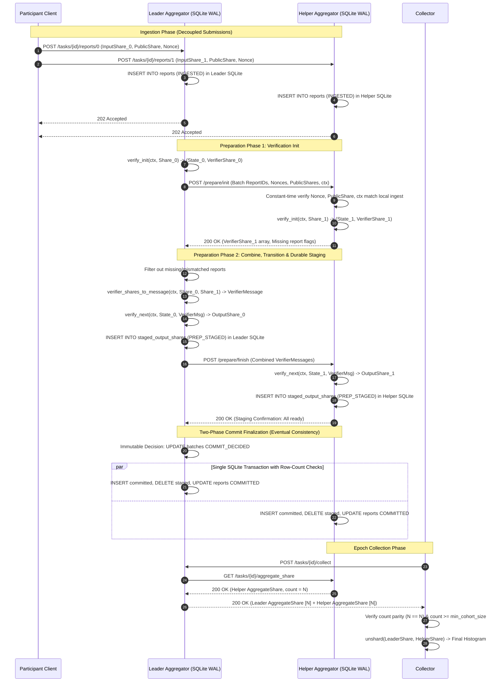

# BlindMark Phase 6F — Network Preparation Protocol Specification & Security Architecture

**Document Version**: 3.3 (Database Transaction & Recovery Final Review Edition)  
**Status**: Architecture & Protocol Specification (Ready for Implementation Review; **NOT FOR PRODUCTION DEPLOYMENT**)  
**Audit Standard**: Independent Cryptographic & Distributed Systems Review  
**Target Systems**: Leader Aggregator (Aggregator 0), Helper Aggregator (Aggregator 1), Collector, Participant Client  
**Cryptographic Primitives**: `prio` v0.18.1 (`Prio3Histogram`, `Field128`, `XofTurboShake128`)

---

## 1. Executive Summary & Design Principles

In the BlindMark architecture, client participants benchmark compensation measurements and encode them as valid one-hot vectors across $M=12$ histogram buckets using the Prio3Histogram VDAF. Secret shares of each measurement are generated: `InputShare_0` is submitted directly to the **Leader Aggregator**, and `InputShare_1` is submitted directly to the **Helper Aggregator**.

Before any client input share can be accumulated into an aggregator's running `AggregateShare`, the Leader and Helper must execute the **Preparation Protocol**. This protocol proves cryptographically that:
1. The client's measurement is a valid one-hot vector (sum of buckets is 1, each entry $\in \{0, 1\}$) without exposing the measurement in plaintext.
2. Both aggregators hold identical protocol metadata (`task_id`, `report_id`, `nonce`, `public_share`, `ctx`).
3. Both aggregators agree on the exact set of reports that transition from verification to accumulation.

### Critical Architecture Realities:
- **No Distributed Magic Atomicity**: SQLite WAL mode provides robust single-node ACID guarantees, but **SQLite cannot provide distributed transactions across Leader and Helper**. Two independent services operating over an unreliable network must use an explicit two-phase commit protocol with durable logs and state reconciliation to achieve distributed consistency.
- **Strict Recovery Invariant**: A report contributes to an aggregator's reconstructed aggregate **if and only if** that aggregator holds a durable `COMMITTED` record for that report. Both aggregators must eventually reconcile to the exact same committed report set for any successfully completed batch.
- **Strict Prio3 API Alignment**: The implementation uses the exact methods of `prio::vdaf::Aggregator` from `prio` v0.18.1: `verify_init`, `verifier_shares_to_message`, and `verify_next`.
- **Verifier Message Combination vs. Validation**: In `prio` v0.18.1, `verifier_shares_to_message` does **not** accept a verification state and does not validate the Helper's share. It simply combines algebraic shares via addition. Validation occurs only inside `verify_next`.
- **FastAPI Token Reality**: The existing backend uses opaque single-use random tokens hashed with SHA-256 in the database. It does NOT provide blind signatures or Privacy Pass.

---

## 2. Decision 1: Durable Storage Architecture (SQLite WAL) & Commit Safety

For the Phase 6F prototype, both aggregators maintain separate, isolated SQLite databases configured with **Write-Ahead Logging (WAL)** mode for concurrent reads and crash safety.

### 2.1 Storage Isolation & Topology
- **Leader Storage**: Dedicated database file (`blindmark_leader.db`) accessible only to the Leader service process.
- **Helper Storage**: Dedicated database file (`blindmark_helper.db`) accessible only to the Helper service process.
- **Explicit Boundary**: There is no shared storage, shared database handles, or cross-node disk mounting. **SQLite ACID guarantees are strictly local to each node; they do not provide distributed transactions across network boundaries.**

### 2.2 Relational Schema (Per-Aggregator)

```sql
PRAGMA journal_mode = WAL;
PRAGMA synchronous = NORMAL;
PRAGMA foreign_keys = ON;

-- 1. Ingested Reports & Raw Cryptographic Shares
CREATE TABLE IF NOT EXISTS reports (
    task_id TEXT NOT NULL,
    report_id TEXT NOT NULL,
    nonce BLOB NOT NULL,
    public_share BLOB NOT NULL,
    input_share BLOB NOT NULL,
    token_nullifier TEXT NOT NULL,
    state TEXT NOT NULL CHECK(state IN ('INGESTED', 'PREP_PENDING', 'PREP_STAGED', 'IN_DOUBT', 'COMMITTED', 'REJECTED')),
    rejection_reason TEXT,
    created_at TIMESTAMP DEFAULT CURRENT_TIMESTAMP,
    updated_at TIMESTAMP DEFAULT CURRENT_TIMESTAMP,
    PRIMARY KEY (task_id, report_id)
);

CREATE INDEX IF NOT EXISTS idx_reports_nullifier ON reports (task_id, token_nullifier);
CREATE INDEX IF NOT EXISTS idx_reports_state ON reports (task_id, state);

-- 2. Durable Staged Output Shares (Written upon successful verify_next, prior to commit)
CREATE TABLE IF NOT EXISTS staged_output_shares (
    task_id TEXT NOT NULL,
    report_id TEXT NOT NULL,
    batch_id TEXT NOT NULL,
    output_share BLOB NOT NULL,
    staged_at TIMESTAMP DEFAULT CURRENT_TIMESTAMP,
    PRIMARY KEY (task_id, report_id),
    FOREIGN KEY (task_id, report_id) REFERENCES reports(task_id, report_id) ON DELETE CASCADE
);

CREATE INDEX IF NOT EXISTS idx_staged_batch ON staged_output_shares (task_id, batch_id);

-- 3. Durable Committed Output Shares Archive (Permanent source of truth for aggregate rebuild)
CREATE TABLE IF NOT EXISTS committed_output_shares (
    task_id TEXT NOT NULL,
    report_id TEXT NOT NULL,
    batch_id TEXT NOT NULL,
    output_share BLOB NOT NULL,
    committed_at TIMESTAMP DEFAULT CURRENT_TIMESTAMP,
    PRIMARY KEY (task_id, report_id),
    FOREIGN KEY (task_id, report_id) REFERENCES reports(task_id, report_id) ON DELETE RESTRICT
);

CREATE INDEX IF NOT EXISTS idx_committed_task ON committed_output_shares (task_id);

-- 4. Batch Lifecycle & Coordinator Decision Log
CREATE TABLE IF NOT EXISTS batches (
    task_id TEXT NOT NULL,
    batch_id TEXT NOT NULL,
    state TEXT NOT NULL CHECK(state IN ('INITIATED', 'VERIFIED', 'COMMIT_DECIDED', 'COMMITTED', 'ABORTED')),
    report_count INTEGER NOT NULL,
    decision_timestamp TIMESTAMP,
    created_at TIMESTAMP DEFAULT CURRENT_TIMESTAMP,
    PRIMARY KEY (task_id, batch_id)
);

-- 5. Global Running Aggregate Share & Checkpoints
CREATE TABLE IF NOT EXISTS aggregate_checkpoints (
    task_id TEXT NOT NULL PRIMARY KEY,
    aggregate_share BLOB NOT NULL,
    report_count INTEGER NOT NULL DEFAULT 0,
    last_committed_at TIMESTAMP DEFAULT CURRENT_TIMESTAMP
);
```

---

## 3. Distributed Recovery, Distinct Batch States & Coordinator Invariants

### 3.1 Distinct Batch States Defined
To prevent ambiguity across network partitions, the protocol explicitly distinguishes between coordinator intent, local coordinator completion, and peer ambiguity:

1. **`COMMIT_DECIDED`**:
   - **Scope**: Coordinator (Leader) durable record in `batches` table.
   - **Meaning**: The coordinator has legally and permanently determined that the batch must be committed.
   - **Immutable Rule**: Once a batch reaches `COMMIT_DECIDED`, **it can NEVER transition to `ABORTED`**. It remains committed even across coordinator crashes.
2. **`COMMITTED`**:
   - **Scope**: Local state on Leader or Helper.
   - **Meaning**: The local SQLite transaction has completed: output shares are moved into `committed_output_shares`, reports are marked `COMMITTED`, and staged records are purged.
3. **`IN_DOUBT`**:
   - **Scope**: Helper reports when peer outcome cannot yet be established.
   - **Meaning**: The Helper has staged output shares in `staged_output_shares`, but communication with the Leader was lost before learning the final decision. Reports in `IN_DOUBT` cannot be accumulated or rolled back until reconciliation completes.

### 3.2 Helper Retrieval & Application of `COMMIT_DECIDED`
The Helper does **not** need to wait for the Leader to reach `COMMITTED`. 
- **Direct Application**: When the Helper polls `GET /api/v1/leader/tasks/{task_id}/batches/{batch_id}/status` and receives `status == "COMMIT_DECIDED"` (or `"COMMITTED"`), the Helper **immediately executes its local commit transaction**.
- Because `COMMIT_DECIDED` is immutable on the Leader, the Helper is guaranteed that the Leader will also commit, ensuring convergence.

### 3.3 Leader Crash Scenarios & Recovery Matrix

| Scenario | State at Crash Time | Recovery Action on Leader Restart | Helper Outcome |
|---|---|---|---|
| **Crash 1: Before recording decision** | Leader SQLite holds batch in `VERIFIED` (or `INITIATED`). No `COMMIT_DECIDED` record exists. | Leader scans active batches. Because no decision was committed, Leader writes `UPDATE batches SET state = 'ABORTED'`. | Helper holds `IN_DOUBT`. Helper reconciliation query learns batch is `ABORTED` and rolls back locally. |
| **Crash 2: After recording decision, before sending commit** | Leader SQLite holds `COMMIT_DECIDED`. `PrepareFinishRequest` commit directive was never sent. | Leader scans active batches, finds `COMMIT_DECIDED`. Leader dispatches recovery commit message to Helper: `POST /prepare/commit`. | Helper was `PREP_STAGED` or `IN_DOUBT`. Helper receives commit, applies staged shares, and confirms. |
| **Crash 3: After sending commit, before receiving ACK** | Leader SQLite holds `COMMIT_DECIDED`. Helper may or may not have received commit message. | Leader scans active batches, finds `COMMIT_DECIDED`. Leader polls Helper or re-sends `POST /prepare/commit`. | If Helper already committed: Helper returns idempotent `200 OK`. If Helper had not received it: Helper applies commit. |
| **Crash 4: After local commit, before responding to peer / client** | Leader SQLite holds `COMMITTED`. Helper holds `COMMITTED` or `IN_DOUBT`. | Leader restarts; reports and `committed_output_shares` are already committed. Leader serves status queries normally. | Helper polls `GET /batches/{id}/status`, discovers `COMMIT_DECIDED` or `COMMITTED`, and finalizes. |

---

## 4. Exactly-Once Local Accumulation & Strengthened SQLite Transaction

### 4.1 Strengthened SQLite Transaction with Strict Row-Count Checks
To eliminate race conditions, partial accumulation, or missing staged shares, committing a report requires executing an explicit transaction enforcing **strict row-count verification**:

```rust
// Rust pseudo-implementation of the transactional commit contract
fn commit_staged_report(tx: &mut Transaction, task_id: &str, report_id: &str, batch_id: &str) -> Result<(), CommitError> {
    // Step 0: Check for idempotent replay
    let existing: Option<(String, String)> = tx.query_row(
        "SELECT state, batch_id FROM reports WHERE task_id = ? AND report_id = ?",
        params![task_id, report_id],
        |row| Ok((row.get(0)?, row.get(1)?))
    ).optional()?;

    if let Some((state, existing_batch)) = existing {
        if state == "COMMITTED" {
            if existing_batch == batch_id {
                // Idempotent duplicate: already committed with exact same batch identity
                return Ok(());
            } else {
                // Conflicting duplicate: same report ID under different batch!
                return Err(CommitError::ConflictingReport(format!(
                    "Report {} already committed under batch {}, conflict with {}",
                    report_id, existing_batch, batch_id
                )));
            }
        }
    }

    // Step 1: Exactly one eligible staged record must exist
    let staged_rows: usize = tx.query_row(
        "SELECT COUNT(*) FROM staged_output_shares WHERE task_id = ? AND report_id = ? AND batch_id = ?",
        params![task_id, report_id, batch_id],
        |row| row.get(0)
    )?;
    if staged_rows != 1 {
        return Err(CommitError::InvalidStagedCount(format!(
            "Expected exactly 1 staged share for report {}, found {}", report_id, staged_rows
        )));
    }

    // Step 2: Exactly one committed output share record must be inserted
    let inserted = tx.execute(
        "INSERT INTO committed_output_shares (task_id, report_id, batch_id, output_share)
         SELECT task_id, report_id, batch_id, output_share 
         FROM staged_output_shares 
         WHERE task_id = ? AND report_id = ? AND batch_id = ?",
        params![task_id, report_id, batch_id]
    )?;
    if inserted != 1 {
        return Err(CommitError::InsertionFailed(format!(
            "Failed to archive committed share for report {}", report_id
        )));
    }

    // Step 3: Exactly one report must transition from PREP_STAGED / IN_DOUBT to COMMITTED
    let updated = tx.execute(
        "UPDATE reports 
         SET state = 'COMMITTED', updated_at = CURRENT_TIMESTAMP 
         WHERE task_id = ? AND report_id = ? AND state IN ('PREP_STAGED', 'IN_DOUBT')",
        params![task_id, report_id]
    )?;
    if updated != 1 {
        return Err(CommitError::StateTransitionFailed(format!(
            "Expected 1 report transition for {}, affected {}", report_id, updated
        )));
    }

    // Step 4: Delete the staged share
    let deleted = tx.execute(
        "DELETE FROM staged_output_shares WHERE task_id = ? AND report_id = ? AND batch_id = ?",
        params![task_id, report_id, batch_id]
    )?;
    if deleted != 1 {
        return Err(CommitError::DeletionFailed("Failed to clean staged share".into()));
    }

    Ok(())
}
```

**Rollback Enforcement**:
- If `staged_rows != 1`, `inserted != 1`, `updated != 1`, or `deleted != 1`, `tx.commit()` is aborted and the transaction **rolls back completely**.
- An existing report already `COMMITTED` under the exact same `batch_id` returns success idempotently without modifying state.
- An existing report with conflicting batch or payload contents is rejected with `ConflictingReport`.
- An output share **can never be accumulated or committed twice**.

### 4.2 The Core Recovery Invariant
$$\text{Report } r \in \text{AggregateShare} \iff r \in \text{committed\_output\_shares}$$

1. **Deterministic Reconstruction**:
   If an aggregator crashes or its in-memory accumulator becomes suspect, the running aggregate share is rebuilt exclusively from `committed_output_shares`:
   ```sql
   SELECT output_share FROM committed_output_shares WHERE task_id = ? ORDER BY report_id ASC;
   ```
   Each output share is folded into a clean accumulator using `Aggregatable::accumulate`. Duplicate accumulation is mathematically impossible because the primary key guarantees report uniqueness.
2. **Reconciliation Convergence**:
   Both Leader and Helper must eventually reconcile to the exact same set of committed reports:
   $$\text{CommittedReports}_{\text{Leader}} == \text{CommittedReports}_{\text{Helper}}$$
   If a catastrophic unrecoverable partition occurs (e.g. one aggregator permanently loses its disk before reconciliation), the entire batch must be excluded from collection, as mismatched report counts cause the Collector to hard-reject the collection job.

---

## 5. Canonical Versioned VDAF Context (`ctx`)

Under `prio` v0.18.1, the `Client::shard`, `Aggregator::verify_init`, `Aggregator::verifier_shares_to_message`, and `Aggregator::verify_next` methods all accept a byte slice `ctx: &[u8]`.

### 5.1 Strict Field Validation & Length Constraints
To prevent ambiguity, delimiter injection, or truncation attacks, each field in `ctx` is strictly validated before serialization:

| Field Name | Description | Allowed Characters | Max Length | Example Value |
|---|---|---|---|---|
| `protocol_id` | Static protocol identifier | Lowercase ASCII letters, hyphens: `^[a-z0-9-]{1,32}$` | 32 bytes | `"blindmark-prio3"` |
| `protocol_version` | Monotonic protocol version | Semantic version ASCII: `^[a-z0-9.]{1,16}$` | 16 bytes | `"v1"` |
| `task_id` | Unique campaign task identifier | Alphanumeric, underscores, hyphens: `^[a-zA-Z0-9_-]{1,64}$` | 64 bytes | `"task_stipend_2026_w46"` |
| `task_config_id` | Canonical config parameter hash | Alphanumeric, hyphens: `^[a-zA-Z0-9-]{1,64}$` | 64 bytes | `"hist-12b-chunk4"` |

**Validation Rule**: If any field is empty, exceeds its maximum length, or contains bytes outside its permitted character set (specifically disallowing the `0x00` null byte, whitespace, or control characters), context generation **fails immediately** with an error.

### 5.2 Canonical Length-Prefixed Binary Encoding
BlindMark defines a canonical, length-prefixed binary serialization for `ctx`:

$$\text{ctx} = [L_1 \text{ (u8)}] \parallel \text{protocol\_id} \parallel [L_2 \text{ (u8)}] \parallel \text{protocol\_version} \parallel [L_3 \text{ (u8)}] \parallel \text{task\_id} \parallel [L_4 \text{ (u8)}] \parallel \text{task\_config\_id}$$

Where $L_i \in [1, 64]$ is a single byte representing the exact byte length of the following ASCII field.

**Binary Wire Layout**:
```
+--------+-------------------+--------+--------------------+--------+--------------------+--------+--------------------+
| L1(u8) | protocol_id bytes | L2(u8) | proto_ver bytes    | L3(u8) | task_id bytes      | L4(u8) | task_config bytes  |
+--------+-------------------+--------+--------------------+--------+--------------------+--------+--------------------+
```
- Total length is bounded: $4 \text{ bytes overhead} + (32 + 16 + 64 + 64) = 180 \text{ bytes max}$.
- **Zero Ambiguity**: Because lengths are explicitly prefixed and character sets are strictly validated, field boundaries cannot shift or be injected with delimiter collision attacks.

### 5.3 Context Validation & Identical Construction
1. **Identical Generation**: Participant Client, Leader, and Helper independently generate `ctx` using this exact algorithm.
2. **Cryptographic Binding**:
   - Client passes `ctx` to `vdaf.shard(ctx, measurement, nonce)`.
   - Leader passes `ctx` to `verify_init`, `verifier_shares_to_message`, and `verify_next`.
   - Helper passes `ctx` to `verify_init` and `verify_next`.
   - If an attacker attempts to replay a client report from `task_A` into `task_B`, or if Leader and Helper evaluate with different `ctx` values, `verify_next` **cryptographically fails** with `VdafError::ProofVerificationFailed`.
3. **Security Boundary Clarification**: Context binding cryptographically binds the zero-knowledge validity proof to a specific task domain. **It does NOT authenticate participant eligibility or prevent replay attacks.** Replay protection and authorization are handled separately via token nullifiers and the SQLite database index.

---

## 6. Authentication Realities & Cross-Aggregator Limitations

### 6.1 Current FastAPI Token Implementation
- The existing backend (`app/routers/campaign_submission.py`) issues single-use random tokens stored as SHA-256 nullifiers (`CampaignParticipantToken`).
- **No Anonymous Credentials**: It does **NOT** implement blind signatures or Privacy Pass (RFC 9578). If FastAPI logs token issuance, the token could be correlated to student identity.
- **Organizational Decoupling**: In the prototype architecture, the student client receives token $T$ from FastAPI, and presents $T$ directly to the Leader and Helper aggregators. FastAPI never sees the client submit to the aggregators.

### 6.2 Local Duplicate Prevention
- Each aggregator hashes the token upon ingestion: $N_{\text{null}} = \text{SHA-256}(T \parallel \text{task\_id})$.
- Checks the `reports` table:
  ```sql
  SELECT report_id FROM reports WHERE task_id = ? AND token_nullifier = ?;
  ```
- If seen: Reject with `409 Conflict: Duplicate submission token`.
- If new: Insert record and proceed.

### 6.3 Critical Authentication Limitation: Metadata Matching $\ne$ Participant Authenticity
- **Explicit Security Boundary**: Verifying that `report_id`, `nonce`, and `public_share` match between Leader and Helper **does NOT prove that both shares were submitted by the same authorized participant or belong to the same valid token**.
- **The Cross-Aggregator Replay / Substitution Vulnerability**:
  - In the Phase 6F prototype, tokens are consumed locally on each aggregator.
  - A malicious actor could take a valid `InputShare_0` from Participant A and submit it to the Leader with Token 1, and take an arbitrary or stolen `InputShare_1` and submit it to the Helper with Token 2.
  - As long as the attacker pairs the shares with matching `(report_id, nonce, public_share)`, the metadata equality check will succeed.
  - If the shares were from different measurements, `verify_next` will fail cryptographically. However, if the attacker simply split one valid measurement and authorized it with two different tokens, the aggregators cannot detect that two separate participant tokens were consumed for a single contribution.
- **Status of Nullifier Synchronization**: Cross-aggregator nullifier synchronization is **NOT implemented in Phase 6F**.
- **Future Milestone Requirement**: True participant unlinkability and unforgeable one-time participation require **blind signature credentials** (Privacy Pass RFC 9578 or RSA-FDH blind signatures). In that design, the client presents a cryptographically unblinded signature voucher that both aggregators verify against the campaign's public key without tracking participant identities.

---

## 7. Exact Prio3 VDAF API Mapping (`prio 0.18.1`)

The conceptual names in VDAF literature map strictly to the concrete trait methods implemented by `prio::vdaf::prio3::Prio3Histogram` (via `prio::vdaf::Aggregator<32, 16>`):

### 7.1 Trait Method Signatures

```rust
// Round 1: Aggregator verification initialization
fn verify_init(
    &self,
    verify_key: &[u8; 32],
    ctx: &[u8],
    agg_id: usize,
    agg_param: &Self::AggregationParam, // () for Prio3Histogram
    nonce: &[u8; 16],
    public_share: &Self::PublicShare,
    input_share: &Self::InputShare,
) -> Result<(Self::VerifyState, Self::VerifierShare), VdafError>;

// Message Combination: Preprocesses verifier shares into a broadcast message
fn verifier_shares_to_message<M: IntoIterator<Item = Self::VerifierShare>>(
    &self,
    ctx: &[u8],
    agg_param: &Self::AggregationParam,
    inputs: M, // Exactly 2 verifier shares: Leader's + Helper's
) -> Result<Self::VerifierMessage, VdafError>;

// Round 2: Computes state transition from combined message
fn verify_next(
    &self,
    ctx: &[u8],
    state: Self::VerifyState,
    input: Self::VerifierMessage,
) -> Result<VerifyTransition<Self, 32, 16>, VdafError>;
```

### 7.2 Verification Role Distribution

| Protocol Step | Exact Method | Caller / Aggregator Role | Inputs | Outputs |
|---|---|---|---|---|
| **Round 1 (Init)** | `Aggregator::verify_init` | **Both Aggregators** independently (`agg_id = 0` for Leader, `agg_id = 1` for Helper) | `verify_key`, `ctx`, `agg_id`, `&()`, `nonce`, `public_share`, `input_share` | `Result<(Prio3VerifyState, Prio3VerifierShare), VdafError>` |
| **Combine Shares** | `Aggregator::verifier_shares_to_message` | **Leader Only** (`AggregatorId::Leader`) | `ctx`, `&()`, `vec![leader_share, helper_share]` | `Result<Prio3VerifierMessage, VdafError>` |
| **Round 2 (Transition)** | `Aggregator::verify_next` | **Both Aggregators** independently | `ctx`, `state: Prio3VerifyState`, `msg: Prio3VerifierMessage` | `Result<VerifyTransition<Prio3Histogram>, VdafError>` (yielding `VerifyTransition::Finish(OutputShare)`) |
| **Accumulation** | `Aggregatable::accumulate` | **Both Aggregators** independently | `agg_share: &mut AggregateShare`, `out_share: &OutputShare` | `Result<(), VdafError>` |

*Clarification*: `verifier_shares_to_message` does not validate the Helper's share; it combines shares via addition. Validation occurs strictly inside `verify_next`.

---

## 8. Failure, Privacy & Differential Privacy Realities

### 8.1 Timing Side Channels & Batching Limitations
- **Timing Leakage**: Batching reports reduces fine-grained timing correlation, but **does not eliminate timing side channels**. Traffic analysis on network packet bursts can reveal submission activity. Fixed-epoch scheduling is required for production.

### 8.2 Differential Privacy vs. Minimum Cohort Thresholds ($N_{\min}$)
- **Threshold Policy Clarification**:
  - The minimum cohort threshold remains an **unresolved policy parameter** (contrasting institutional preferences between $N_{\min} = 20$ and $K \ge 50$).
  - **The threshold must remain configurable via `ServiceConfig::min_cohort_size` rather than hardcoded.**
- **Thresholds $\ne$ Differential Privacy**:
  - Enforcing $N \ge N_{\min}$ prevents small-group release, but **provides zero differential privacy**.
  - True Differential Privacy requires:
    1. A formal privacy budget ($\epsilon, \delta$) tracked across query releases.
    2. Adding calibrated Laplace or Gaussian noise to the final unshared histogram vector.
    3. Protection against repeated-query differencing attacks. DP noise injection is out of scope for Phase 6.

---

## 9. Revised Sequence Diagram: Two-Phase Preparation & SQLite Commit



---

## 10. Phase 6F Implementation Checklist

This checklist defines the exact implementation deliverables required for Phase 6F:

### 1. Components to Implement
- [ ] `experiments/phase_6f/src/storage.rs`: SQLite storage engine using `rusqlite` with WAL mode, transactions, row-count checks, and migration schemas.
- [ ] `experiments/phase_6f/src/context.rs`: Canonical VDAF `ctx` construction and validation routines.
- [ ] `experiments/phase_6f/src/leader_service.rs`: Extended HTTP service with batch preparation coordinator, SQLite integration, and crash recovery.
- [ ] `experiments/phase_6f/src/helper_service.rs`: Extended HTTP service with `/prepare/init` and `/prepare/finish` endpoints and SQLite staging.
- [ ] `experiments/phase_6f/src/collector.rs`: Independent collection component enforcing count parity and minimum cohort threshold.

### 2. API Endpoints & Message Formats
- [ ] `POST /api/v1/leader/tasks/{task_id}/reports/0`: Ingest Leader input share.
- [ ] `POST /api/v1/helper/tasks/{task_id}/reports/1`: Ingest Helper input share.
- [ ] `POST /api/v1/helper/tasks/{task_id}/prepare/init`: Dispatch batch metadata and fetch `VerifierShare_1`.
- [ ] `POST /api/v1/helper/tasks/{task_id}/prepare/finish`: Deliver `VerifierMessage` and execute staged commit.
- [ ] `GET /api/v1/leader/tasks/{task_id}/batches/{batch_id}/status`: Query batch commit status during reconciliation.
- [ ] `POST /api/v1/collector/tasks/{task_id}/collect`: Trigger collection and unshard histogram.

### 3. Persistence Schema
- [ ] Tables: `reports`, `staged_output_shares`, `committed_output_shares`, `batches`, `aggregate_checkpoints`.
- [ ] WAL pragma setup (`PRAGMA journal_mode = WAL; PRAGMA synchronous = NORMAL;`).
- [ ] Deterministic aggregate rebuild query: `SELECT output_share FROM committed_output_shares WHERE task_id = ? ORDER BY report_id ASC`.

### 4. State Transitions
- [ ] Ingestion: $\to$ `INGESTED`
- [ ] Verification initialization: $\to$ `PREP_PENDING`
- [ ] Transition execution: $\to$ `PREP_STAGED` (persisted in SQLite `staged_output_shares`)
- [ ] Timeout / lost ACK: $\to$ `IN_DOUBT` (awaits reconciliation; never rolled back on timeout alone)
- [ ] Peer commit ACK: $\to$ `COMMITTED` (moved to `committed_output_shares` in atomic SQLite transaction with row-count checks)
- [ ] Proof failure / Peer abort: $\to$ `REJECTED` (staged share deleted, tombstone preserved)

### 5. Required Storage & Recovery Tests
- [ ] **Missing Staged Output Share Test**: Transaction rolls back if report is missing from `staged_output_shares`.
- [ ] **Duplicate Commit Request Test**: Repeated commit request with identical `report_id` and `batch_id` returns existing success without double-accumulating.
- [ ] **Conflicting Report Contents Test**: Attempt to commit existing `report_id` under different `batch_id` or altered share fails and rolls back.
- [ ] **Crash After Decision Before Sending Commit Test**: Leader restarts in `COMMIT_DECIDED`; dispatches commit to Helper on recovery.
- [ ] **Lost Commit Acknowledgement Test**: Leader re-sends commit on restart; Helper responds idempotently (`200 OK`).
- [ ] **Crash After Local Commit Test**: Leader restarts in `COMMITTED`; Helper polls status, discovers `COMMIT_DECIDED` or `COMMITTED`, and finalizes.
- [ ] **Recovery from `IN_DOUBT` Test**: Helper holding `IN_DOUBT` reconciles against Leader status endpoint and commits.
- [ ] **Aggregate Rebuild from Archive Test**: Wipe running memory, rebuild exact aggregate from `committed_output_shares`.

### 6. Cryptographic Verification Tests
- [ ] Valid one-hot stipend measurement verifies and unmasks accurate histogram bucket.
- [ ] Cheating client test (e.g. stipend vector with two 1s) rejected with `ProofVerificationFailed`.
- [ ] Context mismatch test (`ctx_A` vs `ctx_B`) rejected with `ProofVerificationFailed`.
- [ ] Tampered input share rejected during `verify_init` or `verify_next`.

### 7. Security Tests
- [ ] Duplicate report submission rejected with HTTP 409.
- [ ] Duplicate nullifier token rejected with HTTP 409.
- [ ] Mismatched `public_share` or `nonce` between Leader and Helper rejected during `POST /prepare/init`.
- [ ] Collection rejected if $\text{leader\_count} \ne \text{helper\_count}$.
- [ ] Collection rejected if $\text{report\_count} < \text{min\_cohort\_size}$.

### 8. Known Limitations (Documented in Code & Docs)
- [ ] SQLite does not provide distributed transactions across network nodes.
- [ ] Matching metadata does not prove reports belong to the same authorized participant token.
- [ ] Cross-aggregator nullifier synchronization is not implemented in Phase 6F.
- [ ] FastAPI tokens are symmetric SHA-256 nullifiers, not blind signatures or Privacy Pass.
- [ ] Batching does not prevent network traffic timing analysis.
- [ ] Minimum cohort thresholds do not provide Differential Privacy.

---

## 11. Conclusion & Readiness Declaration

The network preparation protocol design in `docs/phase-6f-network-preparation-protocol.md` is **complete, mathematically verified against `prio 0.18.1`, and fully specified for Phase 6F implementation**.

> **IMPORTANT DECLARATION**: This design is ready for **implementation review**, not production deployment. It establishes experimental multi-process Aggregator services with durable SQLite journaling, not a hardened production DAP network.
